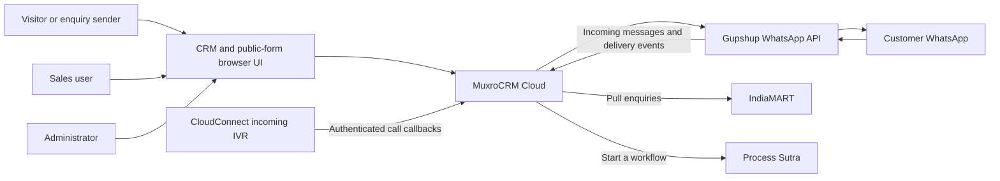
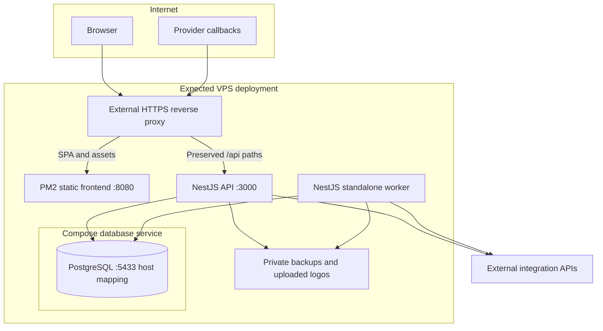
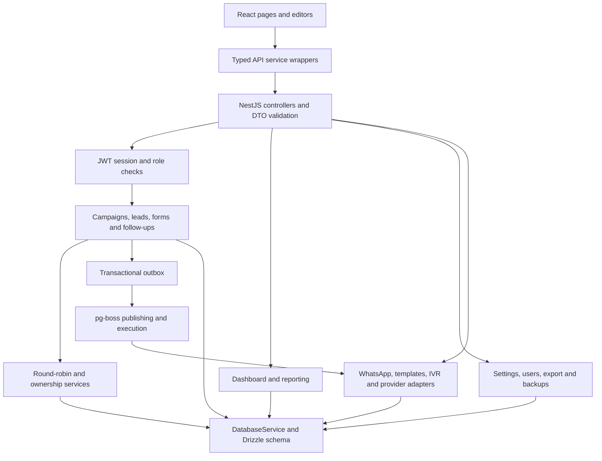
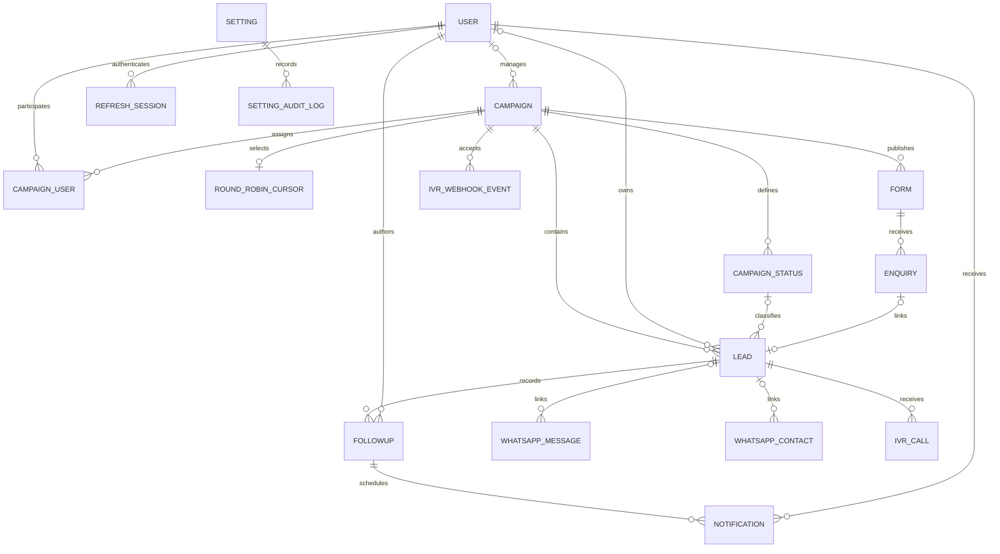
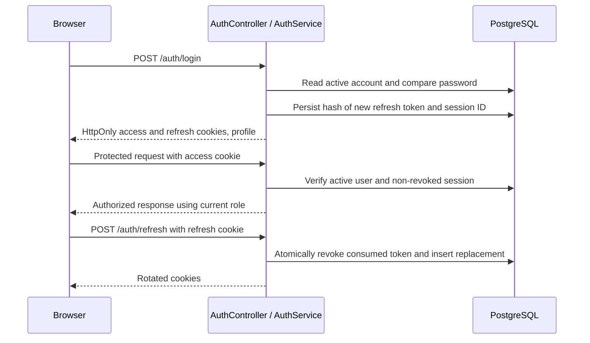
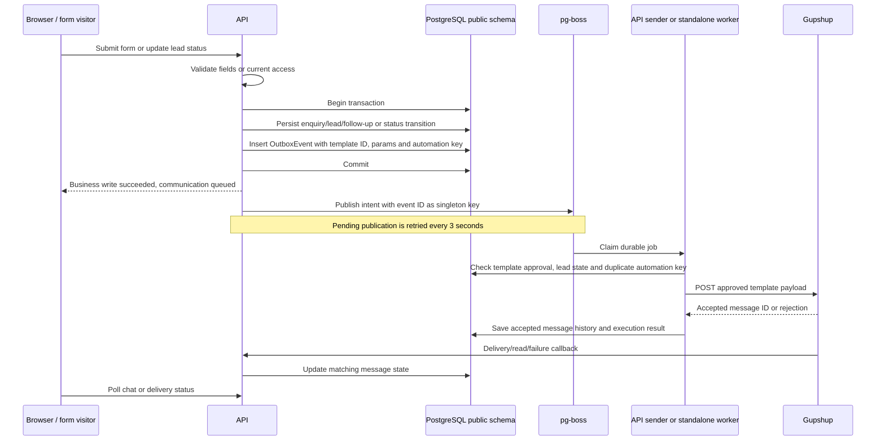
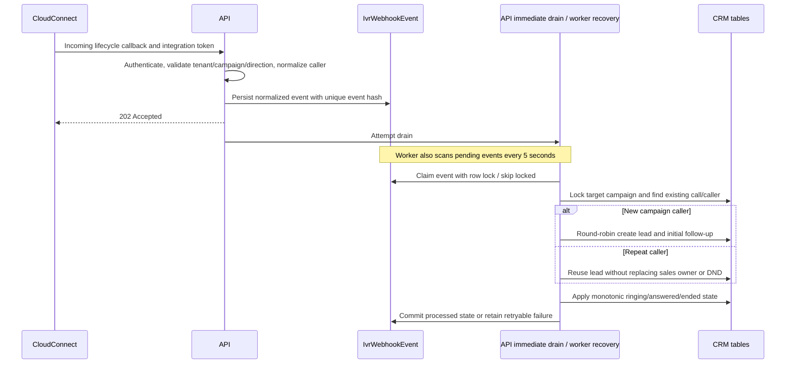

# MuxroCRM Cloud — architecture

**As implemented at:** `c5de389` · **Reviewed:** 17 October 2026.

This is a description of the current system and its observed boundaries. Proposed changes are explicitly identified. Operational defects and recommendations are in the [system audit](SYSTEM_AUDIT.md); configuration and runbooks are in the [technical document](TECHNICAL_DOCUMENTATION.md).

## 1. Architectural shape

The system is a **modular monolith** with a browser SPA, an HTTP API, an optional standalone worker and one PostgreSQL database. API and worker share domain services, settings, tables and queue definitions. They are separate operating-system processes, not independently owned microservices.

Public enquiry submission, administrator configuration and sales work share the API. External integration adapters call fixed provider endpoints. Incoming provider callbacks cross a separate authentication boundary from interactive CRM requests.

The application is an installation-wide CRM. There is no organization identifier on leads/campaigns/users, no per-organization credential partition and no general database tenant policy. CloudConnect provider tenant IDs do not change this model.

## 2. System context

CloudConnect intake is inbound-only; this adapter does not place outgoing calls. Form greeting and selected status-follow-up communication are Gupshup template sends. Other lead sources do not automatically become form submissions or automatically inherit a form's greeting configuration.

## 3. Runtime containers and deployment boundary

The reverse proxy and its TLS/access-log configuration are external to this repository. The PM2 configuration assumes one API and one worker instance. Compose currently provisions only PostgreSQL 15, bound to loopback host port 5433. The API should not be mistaken for a database container peer at host port 5432.

The API starts a consumer for automated form/status template messages, allowing these flows on an API-only VPS. The standalone worker registers ten job processors and also recovers CloudConnect inbox events. It remains necessary for IVR retry/restart recovery and other worker-only background jobs.

Both processes open an application database pool and a separate pg-boss pool. `DB_POOL_MAX=5` bounds the application pool per process; it does not bound all PostgreSQL connections used by the installation. Add worker/queue/backup/administrative connections when planning capacity.

The Node 20 backend Dockerfile is below pg-boss's supported Node runtime and has missing build/runtime resources. This deployment path has not been validated as runnable; see F06. The existing PM2 memory limits are restart thresholds, not proof that the combined processes, PostgreSQL, operating system and the separately mentioned Process Sutra service fit a 2 GiB host.

## 4. Logical components

| Component | Responsibility | Boundary considerations |
| --- | --- | --- |
| Frontend pages | Route-level features and local presentation/filter state | Browser role checks are not backend authorization; several pages load large data sets before local pagination |
| Auth module | Sign-in, refresh rotation, logout and current-session validation | Current database role/activity/session is authoritative |
| Users module | Account lifecycle and last-admin protection | User changes and session revocation are coordinated transactionally |
| Campaigns/statuses | Campaign administration, membership and status/template configuration | Campaign creation is not atomic across default-status setup (F11) |
| Forms | Public configuration, validation, enquiry/lead creation and form greeting intent | Metadata and answers are JSON; public input is untrusted |
| Leads/follow-ups | Sales ownership, status/DND transitions and history | Status update authorization is vulnerable to a concurrent transfer (F02) |
| Round-robin | Eligible active sales-user selection and persistent cursor | Selection and lead insertion must share one transaction |
| Dashboard | Aggregation and worklists | Campaign-report scope and metric defects remain open (F01/F07) |
| WhatsApp/template adapter | Chat history, inbound parsing, outbound session/template transport and catalog | Two send paths have inconsistent DND enforcement (F03) |
| CloudConnect adapter | Authenticated inbound-call inbox, normalization, retries and operator history | Provider receiving agent is independent of CRM lead owner |
| IndiaMART adapter | Pull/import and query-ID deduplication | Owner assignment and atomicity differ from normal intake (F04) |
| Process Sutra adapter | Starts a provider workflow | Follow-ups still reads legacy browser configuration (F08) |
| Job/outbox modules | Durable publication, shared execution logs and asynchronous transport | Not every declared queue has a processor or recurring schedule |
| Backup/export | Archives, recovery and administrative data operations | Database recovery and CSV business export have different scopes |

`DatabaseModule`, `JobModule`, `OutboxModule` and `BackupModule` expose shared infrastructure. The dedicated Gupshup templates module avoids a direct circular dependency between the broader Integrations and WhatsApp modules. `JobExecutionService` provides the same attempt logging for API-consumed and standalone-worker jobs.

Authorization is not centralized in one resource-policy engine. Controller roles, `AuthorizationService`, resource guards and individual service predicates coexist. A future centralization must preserve the current narrow ownership checks; the generic helper for campaign membership is not interchangeable with write access to an owned lead.

## 5. Persistence and relationships

### Core entity model

The diagram shows domain relationships, not all attributes. The complete 20-table dictionary is in the technical document. `GupshupTemplate`, `OutboxEvent` and `JobLog` also exist, but their IDs/payload references are not all foreign-key relationships and should not be shown as enforced FK edges.

Important enforced keys include unique usernames, campaign/user membership pairs, public slugs, one linked lead per enquiry, IndiaMART query IDs, notification user/follow-up pairs, refresh token hashes, WhatsApp contact phones, template app/ID pairs, IVR event hashes, IVR tenant/call identities and nullable automation keys.

Important application-level invariants include status belonging to the same campaign as its lead, an owner being an eligible salesperson, DND applying consistently to outbound contact, and a transfer invalidating the previous salesperson's write access. These are not all enforced by database constraints; audit findings show where service-level assumptions fail.

### Data classes and durability

| Data class | Location | Recovery/retention implication |
| --- | --- | --- |
| CRM contacts, enquiries, history and attachments | PostgreSQL public tables/JSON | PII is not generally encrypted at the field level; file JSON is duplicated into enquiry/lead data |
| Integration credentials/configuration | Encrypted `Setting` values | Database archive requires the retained encryption key and salt to become usable |
| Authentication session state | Hashed tokens in `RefreshSession` | Restore intentionally invalidates sessions |
| Provider message and call metadata | WhatsApp/IVR tables and raw/normalized JSON | Deduplication and scope depend on correct IDs, normalization and linked leads |
| Pending automatic communication | Outbox and pg-boss | Durable across ordinary restart; canceled/cleared by restore and bulk deletion procedures |
| Logos | Local `uploads/logos` | Not part of a database-only archive |
| Database backups | Private `BACKUP_DIR` files | Local archives alone do not establish offsite disaster recovery |
| Browser profile/preferences | Browser storage | Not an authorization or central configuration authority |

Soft deletion is selective. Leads use a deleted flag and timestamp; campaigns are deactivated. Form deletion detaches lead references and removes enquiries. User hard deletion and campaign-data deletion explicitly coordinate dependent records. These are different business operations with different preservation semantics.

## 6. Main execution sequences

### Login and refresh

JWT expiry alone is not the authorization decision: current account/session state is checked on each protected request. Refresh rotation is transactional and one-use. The client coordinates concurrent refresh requests, but only the server's persisted session state grants access.

### Public form or configured status template

The public submission/status transaction commits before external communication. A provider failure does not delete a legitimate enquiry or undo a recorded sales update. This is intentional eventual consistency, and the UI says queued rather than delivered.

A form greeting comes from that form's Messages configuration. A selected lead-status template comes from the target campaign status. The two share the catalog/sender but retain separate configuration. The caller can turn status communication off; missing phone/DND state disables it in the status dialog.

### Incoming IVR

The IVR operator records who received the call. It does not decide CRM sales ownership. A repeat phone in another campaign is not automatically merged across campaigns. Incoming callbacks do not invoke the CloudConnect outbound API or start a form greeting.

## 7. Transactions, locking and delivery guarantees

| Mechanism | Current purpose | Limit |
| --- | --- | --- |
| Campaign advisory transaction lock | Serialize round-robin selection/intake and allocation cursor updates | Not a general lead-write ownership lock |
| Refresh-session conditional update | Consume a refresh token once during rotation | Requires durable session storage and preserved signing configuration |
| IVR unique event/call keys plus row locks | Prevent duplicate call intake and concurrent event application | Identity conflicts remain failed/retryable events for investigation |
| Template automation advisory lock and unique key | Prevent repeat successful execution for one form submission/follow-up | Cannot eliminate a crash between provider acceptance and local message commit |
| Transactional outbox | Couple an intended greeting with the lead/follow-up write | Queue publication and external provider acceptance are separate transactions |
| Maintenance advisory lock | Coordinate backup/restore/deletion with selected intake/send paths | Requires other database clients/workers to stop for restore; not every arbitrary mutation is a maintenance-aware job |

The practical communication guarantee is **at least once processing with application deduplication**, not mathematically exactly-once delivery. The external provider and PostgreSQL do not participate in a distributed transaction. A process crash after Gupshup accepts a message but before message history commits can cause a retry to send again. Provider-side idempotency support or reconciliation is needed to close that gap.

The message sender currently holds a database transaction/lead share lock across the outbound provider request. This supports state/deduplication checks but ties up a pool connection and can delay lead writers during provider slowness. This is a capacity/latency tradeoff, not proof of a measured outage.

Retry defaults are three pg-boss retries after the initial attempt. IVR uses its own inbox retry state with capped backoff and five total attempts. Queue publication failures retain the outbox intent. A successful provider submission, a published outbox record and a customer-delivered message are three different facts.

## 8. Security boundaries

- Public forms cross an unauthenticated input boundary. Published/active checks, field validation, rate limits and request/attachment size limits are implemented; there is no CAPTCHA or external malware scanner in this runtime.
- Interactive requests cross cookie/bearer authentication, current-session validation, role guards and service ownership checks. A client-side route redirect is not a substitute for those checks.
- Provider callbacks use integration-specific shared secrets, not a CRM user session. Tokens in callback URLs require redaction at both application and proxy layers. Repeated IVR/message events use identity-based deduplication rather than a general signed-timestamp replay protocol.
- Integration credentials are encrypted in PostgreSQL. Encryption inputs are process-level secrets and are not included as usable plaintext in database archives.
- Files have different trust models: logos receive MIME/extension/signature checks; public form attachments receive encoded-size validation and remain JSON; provider media is referenced by HTTP(S) URL.
- Backend database access uses Drizzle parameter binding and parameterized raw SQL, with a whitelist for dashboard order columns. The audit's confirmed report bug is a missing scope predicate, not SQL injection.

This review found no new demonstrated authentication takeover. It did reproduce an aggregate-report scope leak, a transfer race and a DND bypass. Dependency scanners also reported a critical-severity package advisory. These are recorded separately so package severity is not mistaken for a demonstrated application exploit.

## 9. Operations, observability and availability

Health checks, structured HTTP logs, job-attempt logs, template delivery diagnostics and IVR inbox diagnostics are present. They cover different aspects of the system. Basic database health does not establish that a worker is alive, that all queue handlers exist or that a provider delivered a message.

The general administrator health response can show healthy/running after queue-stat inspection throws; this was reproduced. There is no comprehensive worker heartbeat, alert delivery, service-level objective, distributed trace or enforced retention schedule. Request IDs are logged when supplied, not established as an end-to-end trace contract.

Backups and data export are distinct operations. Restore uses a recovery archive, schema validation, maintenance/drain checks, session invalidation and queue/outbox cancellation. The pg-boss schema is not replayed as part of the public/drizzle database archive. Logos, secrets and host/reverse-proxy configuration require separate recovery.

The topology has a shared database and a single VPS failure domain. Local backups on the same lost host do not provide independent disaster recovery. No evidence in this review establishes an offsite copy, tested production restore interval, HA failover, recovery-time objective or recovery-point objective.

## 10. Architectural decisions and proposed evolution

| Observed decision | Benefit | Current cost / recommended evolution |
| --- | --- | --- |
| Modular monolith | Simple deployment and shared transactions | Keep adapter/domain boundaries clear; avoid assuming module separation creates independent security policies |
| PostgreSQL-backed jobs | No additional queue broker required | Budget queue pools and supervise consumers; distinguish declared queues from implemented processors |
| API also consumes template automation | Form/status sends work without separate worker deployment | Preserve safe multi-consumer/idempotency behavior and add genuine worker/consumer health |
| JSON form schemas and answers | Flexible forms without a migration per field | Add versioned schema validation, field constraints and a considered attachment/storage contract |
| Installation-global settings | Straightforward single-business setup | A multi-tenant product would require explicit organizations, scoped keys/rows and migration design |
| Lead ownership as service policy | Simple sales work separation | Move authorization/state checks into the same locked transaction as mutations; enforce campaign/status integrity |
| Browser polling | Works with current VPS/proxy setup | Replace full-data refreshes with incremental/server-filtered pagination before claiming larger capacity |
| Inline attachments and in-memory exports | Few infrastructure dependencies | Move large objects to controlled storage and stream exports when size/load measurements justify it |
| Provider-specific adapters | Direct access to supplied vendor formats | Reconcile configuration paths, error models, duplicate handling and DND policy across adapters |

Recommended work order is to resolve the reproduced authorization/ownership/DND and import defects, update affected runtime dependencies, repair deployment artifacts, then address reporting correctness, integration scheduling/configuration, observability and scale limits. These changes are recommendations; they are not implemented by this documentation commit.
